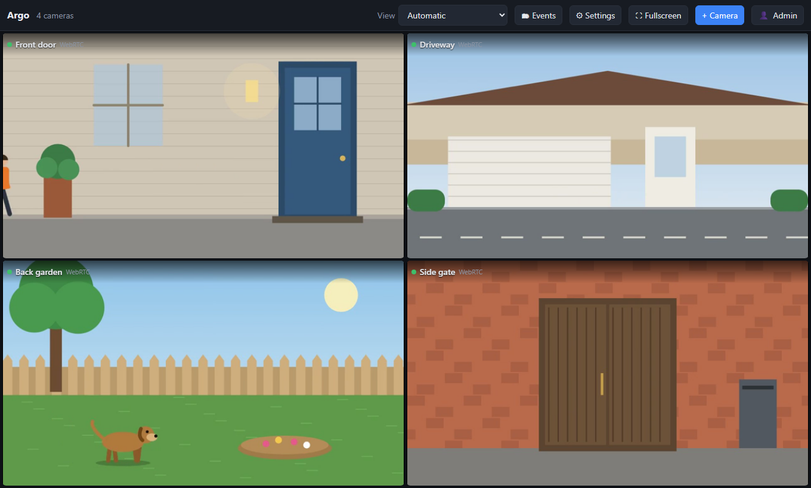
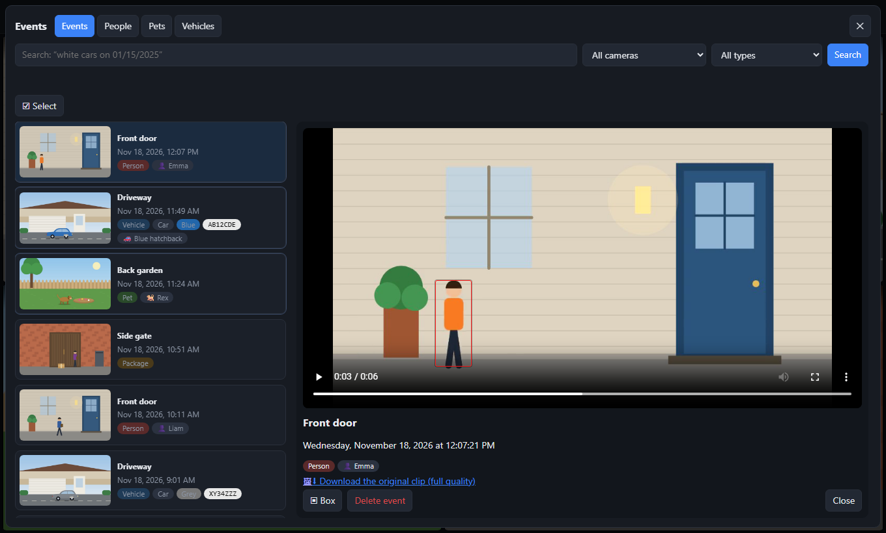
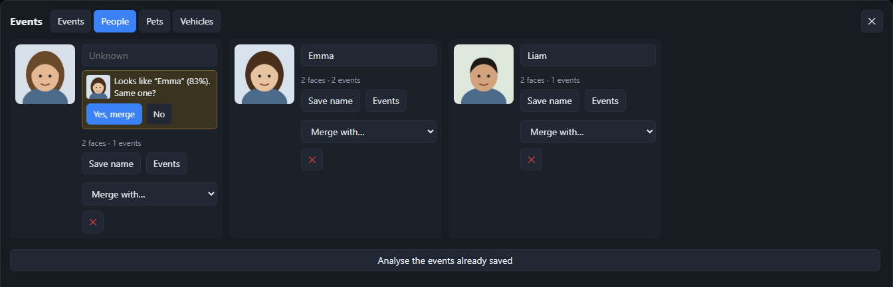
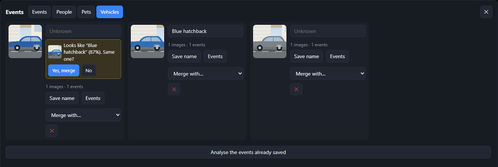
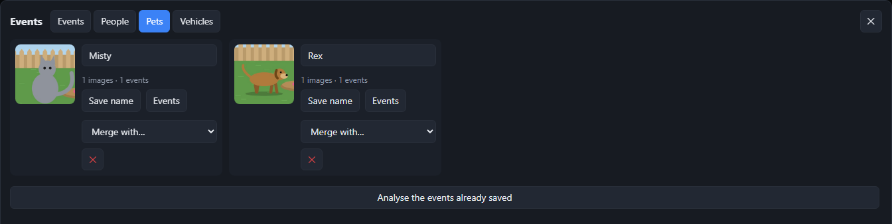
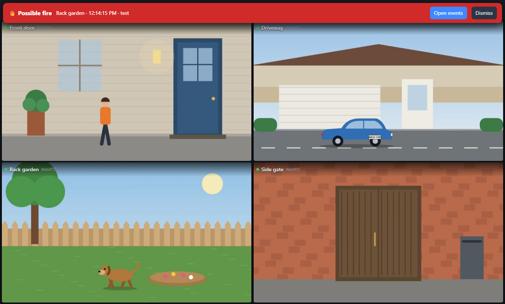
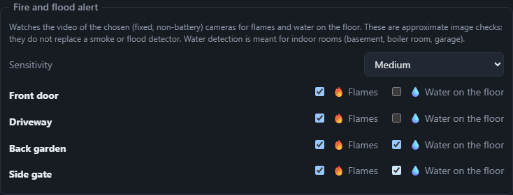

# Argo

*[Read in English](README.md)*

Visualizzatore **multi-telecamera locale** per PC e telefono. Reolink, Eufy (P2P locale, video senza cloud), ONVIF e RTSP in un'unica schermata, con eventi, allarmi, ricerca intelligente e riconoscimento di persone, animali e veicoli. Tutto resta nella tua rete.

> Il servizio/pacchetto interno si chiama ancora `cam-app` (cartelle, unità systemd `cam-app`, utente `camapp`).

## Funzioni

- **Video dal vivo** di molte telecamere (WebRTC tramite [go2rtc](https://github.com/AlexxIT/go2rtc)), interfaccia per telefono e PC, installabile nella schermata Home, 5 lingue (it, en, fr, de, es).
- **Marche**: Reolink (dirette o con Home Hub, anche a batteria), Eufy in P2P locale (senza RTSP; le batterie si possono svegliare a richiesta dove il modello lo consente), ONVIF, RTSP/HTTP generico.
- **Eventi** (movimento, persona, veicolo, animale, pacco, campanello, incendio, allagamento) con immagine, filmato e anteprima H.264 leggera per la riproduzione; l'originale resta alla massima qualità per il download.
- **Ricerca intelligente** in linguaggio naturale («auto bianche passate martedì sera»).
- **Riconoscimento locale** (niente cloud): volti, singoli animali e singoli veicoli hanno una scheda dove dare un nome; un soggetto nuovo che somiglia a uno noto viene **suggerito** per l'unione.
- **Riquadro rosso** in sovraimpressione che segue la figura nei filmati (non inciso nel video, si può togliere).
- **Allerta incendio e allagamento** (controlli euristici sul video, per telecamera, con sirena e banner). Sono approssimativi: **non sostituiscono** un rivelatore di fumo o di allagamento.
- **Archivio di rete**: sposta i filmati vecchi su SMB, WebDAV o cartella montata, restando ricercabili e riproducibili.
- **Utenti e permessi**: amministratore e livelli *Guarda* / *Controlla* per telecamera, password scrypt, blocco dopo tentativi falliti, protezione CSRF.
- Popup del campanello con audio bidirezionale, icone e stato Home Assistant (token solo sul server), icone batteria, pagina per scaricare il certificato sul telefono.

## Immagini

> Solo dati di esempio: telecamere, persone, animali e veicoli qui sotto sono fittizi (illustrazioni, interfaccia in inglese).

**Vista live** di tutte le telecamere in un'unica schermata:



**Eventi** con ricerca e il sottile riquadro rosso che segue il soggetto nel filmato (si può disattivare):



**Persone, animali e veicoli** hanno ciascuno la propria scheda dove dare un nome. Quando uno nuovo somiglia a uno già noto, Argo suggerisce di unirli:







**Allerta incendio e allagamento**: compaiono sirena e banner quando una telecamera vede fiamme o acqua sul pavimento.



Si sceglie per ogni telecamera cosa sorvegliare (controlli approssimativi, non sostituiscono un rilevatore di fumo o di allagamento):



## Avvio rapido (Windows o Linux, per prove)

Servono Node.js 22+, ffmpeg nel `PATH` e il programma [go2rtc](https://github.com/AlexxIT/go2rtc/releases) in `bin/` (`go2rtc.exe` / `go2rtc`).

```bash
npm install
node tools/get-models.mjs   # facoltativo: modelli di riconoscimento (~100 MB)
node server.js              # http://localhost:8780
```

Al **primo avvio** viene creato l'utente `admin` con una password casuale, stampata nel log e scritta in `data/first-run-admin.txt` (si cancella dopo il cambio). In alternativa imposta `ADMIN_USERNAME` e `ADMIN_PASSWORD` prima del primo avvio. Su Windows `start.bat` avvia tutto.

## Installazione su Proxmox (consigliata)

Serve un host Proxmox VE sulla stessa rete di livello 2 delle telecamere (per il rilevamento Eufy) e internet.

1. Sul PC crea il pacchetto: `powershell -File deploy\pack.ps1` → `dist\cam-app.tar.gz`.
2. Copia pacchetto e cartella `deploy` sull'host Proxmox (`scp`).
3. Sull'host, come root:

   ```bash
   bash deploy/proxmox/create-ct.sh --tarball cam-app.tar.gz --ip dhcp
   # IP fisso:  --ip 192.168.1.90/24 --gw 192.168.1.1     VLAN: --vlan 20
   # altre opzioni: --ctid, --cores, --memory, --disk, --storage, --bridge, --pubkey FILE, --with-models, --with-eufy-login
   ```

   Crea un CT Debian non privilegiato (2 core, 2 GB, 32 GB), installa Node 22, ffmpeg, go2rtc, un certificato HTTPS autofirmato e il servizio `cam-app`, poi stampa l'indirizzo.
4. Apri `https://IP-DEL-CT:8780` (conferma il certificato autofirmato una volta; la pagina *Certificato* aiuta sul telefono).

**Porte**: `8780/tcp` (interfaccia) e `8555/tcp+udp` (WebRTC). Se i client sono in un'altra rete la 8555 deve essere raggiungibile, altrimenti il video ripiega su HTTP, più pesante. `WEBRTC_CANDIDATES` in `/etc/cam-app.env` deve contenere l'indirizzo del CT.

**Aggiornare**: crea un nuovo pacchetto, copialo nel CT ed esegui `bash /root/install.sh --tarball /root/cam-app.tar.gz`. I dati in `/var/lib/cam-app` non si toccano. Prima fai uno snapshot da Proxmox.

**Dati e backup**: tutto sta in `/var/lib/cam-app` (`cameras.json` con le credenziali, `cam-app.db`, `settings.json`, `eufy-account.json`, `events/`, `models/`). Questi file non vanno condivisi.

## Telecamere Eufy

Video e impostazioni si leggono in locale via P2P. Serve un **accesso una tantum al cloud** per leggere l'ID account e le chiavi dei dispositivi:

```bash
cd tools/eufy-login && npm install
EUFY_CIPHERS="<seriale>=<cipherId>,..." DATA_DIR=/var/lib/cam-app node login.mjs
```

Le credenziali le digiti nel terminale e non vengono salvate. `node tools/eufy-discover.js` trova le telecamere e i cipherID in rete. Le SoloCam a batteria dormono: l'app invia pacchetti di ricerca finché rispondono e si collega subito; alcuni modelli (ad esempio la S340) non rispondono ai pacchetti locali finché dormono, quindi l'app può anche **svegliarli tramite i server P2P di Eufy, come fa l'app ufficiale** (dal cloud passa solo la richiesta di sveglia; il video resta locale). Per attivarlo, esegui ancora una volta:

```bash
cd tools/eufy-login && DATA_DIR=/var/lib/cam-app node login.mjs --wake-only
```

Salva `eufy-cloud.json` (server P2P e una chiave di sveglia temporanea di circa 30 minuti) ed `eufy-session.json` (il **token di accesso Eufy, non la password**, valido circa 30 giorni), entrambi con permessi ristretti. L'app rinnova da sola la chiave con il token; quando il token scade (lo dice il log) si rilancia il comando. Con `--no-session` il token non viene salvato (la sveglia funziona solo per 30 minuti dopo ogni accesso); cancellando `eufy-session.json` si toglie l'accesso.

## Variabili d'ambiente

| Variabile | Significato |
|---|---|
| `DATA_DIR` | cartella dei dati (predefinita `./data`) |
| `HOST`, `PORT` | indirizzo e porta (predefiniti `127.0.0.1`, `8780`; `0.0.0.0` nel CT) |
| `TLS_CERT`, `TLS_KEY` | certificato e chiave per HTTPS |
| `TRUST_PROXY=1` | si fida di `X-Forwarded-*` (dietro reverse proxy; inoltra anche i WebSocket) |
| `WEBRTC_CANDIDATES` | `IP:8555` con cui i client raggiungono il video |
| `GO2RTC_BIN` | percorso di go2rtc |
| `INTERNAL_PORT` | porta solo-loopback del flusso Eufy (predefinita `PORT+1`) |
| `ADMIN_USERNAME`, `ADMIN_PASSWORD` | amministratore del primo avvio |

Microfono (parlare al campanello) e notifiche del browser richiedono HTTPS.

## Limiti noti

- I messaggi d'errore dei dispositivi sono in italiano; l'interfaccia è tradotta.
- Le credenziali delle telecamere stanno in chiaro (permessi 600): tieni telecamere e server in una rete dedicata.
- Il video Eufy in H.265 (S340) richiede un browser che decodifichi H.265.
- Incendio/allagamento sono controlli euristici; la precisione del riconoscimento dipende dalla qualità delle telecamere e dalle soglie (regolabili nelle Impostazioni).

Vedi [SECURITY.md](SECURITY.md) e [THIRD_PARTY.md](THIRD_PARTY.md). Licenza [MIT](LICENSE).
