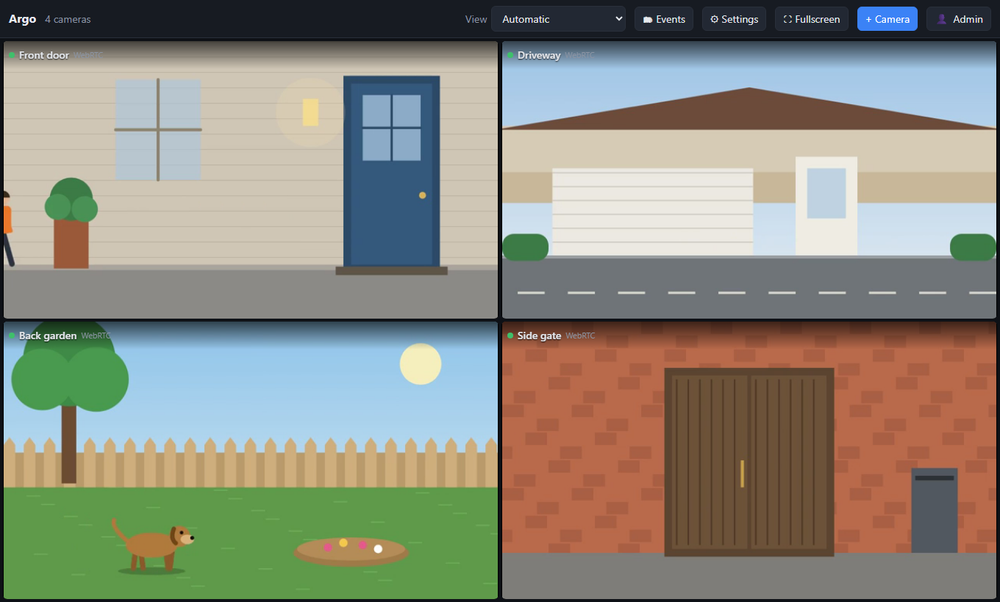
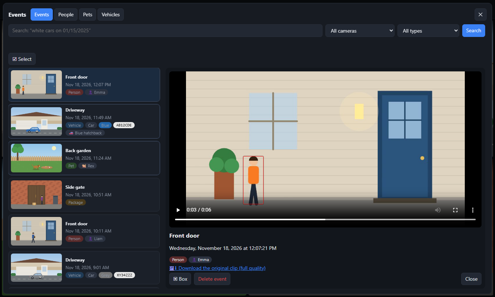
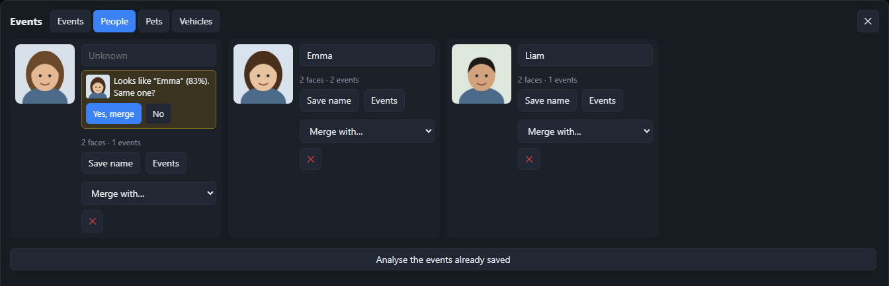
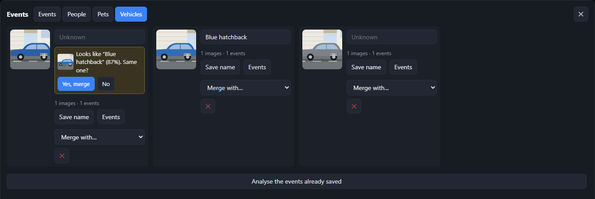
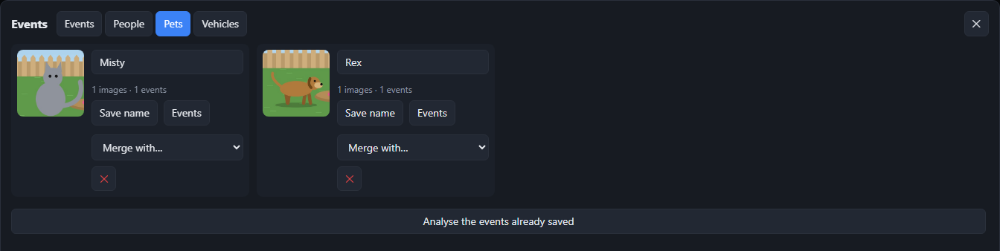
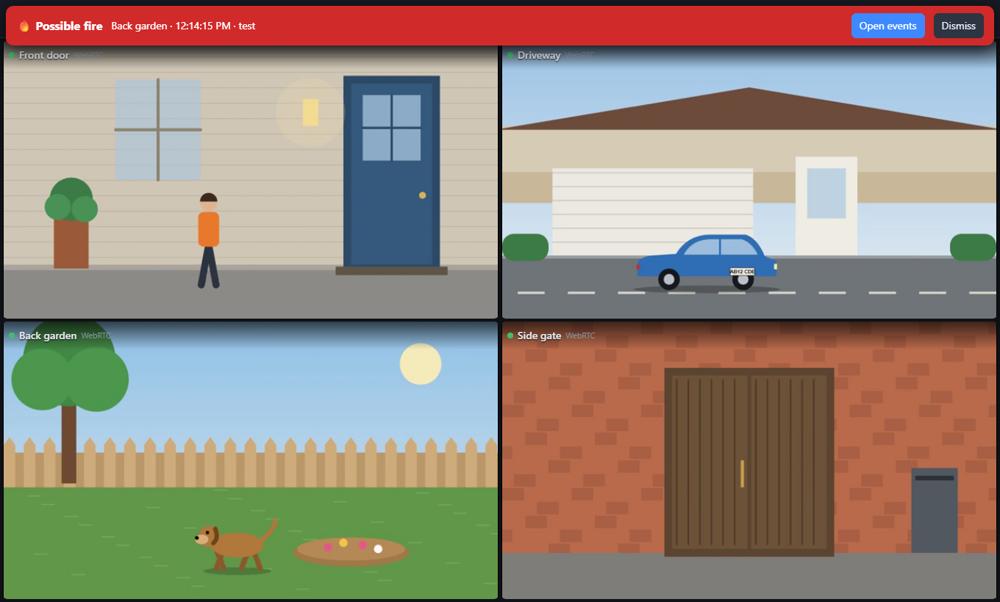
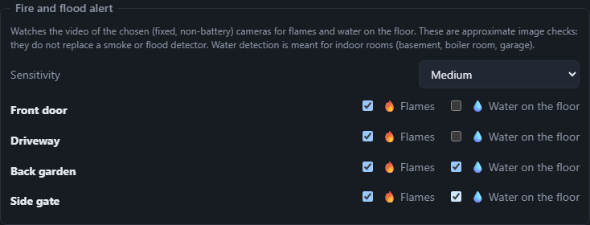

# Argo

*[Leggi in italiano](README.it.md)*

A **local-first multi-camera viewer** for PC and phone. Watch Reolink, Eufy (local P2P, no cloud video), ONVIF and plain RTSP cameras on one screen, with events, alerts, smart search and on-device recognition of people, pets and vehicles. Everything stays on your network.

## Features

- **Live view** of many cameras (WebRTC through [go2rtc](https://github.com/AlexxIT/go2rtc)), responsive UI for phone and desktop, installable as a home-screen app, 5 languages (it, en, fr, de, es).
- **Automatic camera search** in the *New camera* dialog: a progress bar while Argo looks on the local network (ONVIF discovery, Eufy broadcast, port scan with Reolink/Hikvision/Dahua/RTSP recognition) and lists only the cameras that are not added yet, ready to fill in the form. Cameras paired to a **Reolink Home Hub / NVR** have no address of their own: the search also asks the hub for its channels (using the credentials of a camera already added on that hub, or those typed in the form for a new hub) and lists the channels not added yet; the password never reaches the browser. It scans the server's own private network (up to a /22).
- **Brands**: Reolink (direct or through a Home Hub, including battery cameras), Eufy over local P2P (no RTSP needed, battery cameras can be woken on request where the model allows it), ONVIF, generic RTSP/HTTP.
- **Events** (motion, person, vehicle, pet, package, doorbell, fire, flood) with snapshot, clip and a lightweight H.264 preview for playback; the original clip stays at full quality for download.
- **Smart search** in natural language ("white cars last Tuesday evening").
- **Local recognition** (no cloud): faces, individual pets and individual vehicles get their own tab where you name them; new subjects that look like a known one are *suggested* for merging. A video can show several people, pets or vehicles at once: each is recognised and shown on the event, and the admin can change, remove or add subjects (and move or remove the learned images) when a match is wrong.
- **Red overlay box** that follows the subject in event clips (drawn on top of the video, can be switched off).
- **Fire / flood alerts** (heuristic checks on camera video, per camera, with siren and banner). They are approximate and **do not replace** a smoke or flood detector.
- **Eufy events from the cloud**: the push notifications Eufy sends to its phone app (person, motion, pet, vehicle, doorbell) become Argo events with the preview image, also for battery cameras. Needs the Eufy sign-in and the helper tool (`install.sh --with-eufy-login`).
- **Reolink hub recordings** appear in the event list (light copy downloaded from the hub or SD card, original downloadable), each event tagged with its source (internal, archive, Reolink hub, Eufy cloud).
- **Event tags and false alarms**: filter events by several tags at once; remove a tag; mark a fire/flood event as a false alarm and the camera learns to ignore that area.
- **Live view controls**: stop/start any camera, a floating (picture-in-picture) window for the selected camera, an offline camera shows its last image in green, and a per-camera button opens its events.
- **Network archive**: move old clips to SMB, WebDAV or a mounted folder while keeping them searchable and playable.
- **Users and permissions**: admin and per-camera *watch* / *control* levels, scrypt passwords, brute-force lockout, CSRF protection.
- Doorbell popup with two-way audio, Home Assistant icons/state (read-only token stored server side; monochrome Home Assistant icons with a multilingual search box, plus emoji), battery level icons, certificate download page for phones.

## Screenshots

> Demo data only: the cameras, people, pets and vehicles below are fictional, illustrated placeholders.

**Live view** of all cameras on one screen:



**Events** with search, and the thin red box that follows the subject in the clip (it can be switched off):



**People, pets and vehicles** each get their own tab, where you name them. When a new one looks like a known subject, Argo suggests merging them:







**Fire and flood alerts**: a siren and a banner appear when a camera sees flames or water on the floor.



Choose per camera what to watch (heuristic checks, not a replacement for a smoke or flood detector):



## Quick start (Windows or Linux, for testing)

Requirements: Node.js 22+, ffmpeg in `PATH`, and the [go2rtc](https://github.com/AlexxIT/go2rtc/releases) binary in `bin/` (`go2rtc.exe` / `go2rtc`).

```bash
npm install
node tools/get-models.mjs   # optional: recognition models (~100 MB)
node server.js              # http://localhost:8780
```

On first start an `admin` user is created with a random password, printed in the log and written to `data/first-run-admin.txt` (deleted after you change it). You can also set `ADMIN_USERNAME` / `ADMIN_PASSWORD` before the first start. `start.bat` launches it on Windows.

## Install on Proxmox (recommended)

You need a Proxmox VE host on the same layer-2 network as the cameras (needed for Eufy discovery) and internet access.

1. Build the package on your PC: `powershell -File deploy\pack.ps1` → `dist\cam-app.tar.gz`
2. Copy the package and the `deploy` folder to the Proxmox host (`scp`).
3. On the host, as root:

   ```bash
   bash deploy/proxmox/create-ct.sh --tarball cam-app.tar.gz --ip dhcp
   # static IP: --ip 192.168.1.90/24 --gw 192.168.1.1     VLAN: --vlan 20
   # other options: --ctid, --cores, --memory, --disk, --storage, --bridge, --pubkey FILE, --with-models, --with-eufy-login
   ```

   It creates an unprivileged Debian container (2 cores, 2 GB RAM, 32 GB disk), installs Node 22, ffmpeg, go2rtc, a self-signed HTTPS certificate and the `cam-app` service, then prints the address.
4. Open `https://CT-IP:8780` (accept the self-signed certificate once; the *Certificate* page helps install it on phones).

**Ports**: `8780/tcp` (UI) and `8555/tcp+udp` (WebRTC). If clients are on another network make sure 8555 is reachable, otherwise video falls back to a heavier HTTP stream. `WEBRTC_CANDIDATES` in `/etc/cam-app.env` must hold the CT address.

**Update**: build a new package, copy it into the container and run `bash /root/install.sh --tarball /root/cam-app.tar.gz`. Data in `/var/lib/cam-app` is kept. Take a Proxmox snapshot first.

**Data and backup**: everything lives in `/var/lib/cam-app` (`cameras.json` with camera credentials, `cam-app.db`, `settings.json`, `eufy-account.json`, `events/`, `models/`). Never share these files.

## Eufy cameras

Eufy video and settings are read locally over P2P. A **one-time cloud login** is needed to read your account id and device keys:

```bash
cd tools/eufy-login && npm install
EUFY_CIPHERS="<serial>=<cipherId>,..." DATA_DIR=/var/lib/cam-app node login.mjs
```

You type the credentials in your terminal; they are not stored. Use `node tools/eufy-discover.js` to find cameras and their cipher IDs on the LAN. Battery cameras (SoloCam) sleep: the app sends discovery packets until they answer and connects immediately. Some models (for example the S340) do not answer local packets while asleep, so the app can also **wake them through the Eufy P2P servers, like the official app does** (only the wake request goes through the cloud; video stays local). The easiest way is **Settings → Eufy cameras → Connect account** in the app (admin only): enter your Eufy email and password (and the captcha/code if Eufy asks). They are sent only to the Eufy servers and are not stored; the cameras of the account are then listed with an **Add** button. This needs the login tool installed on the server (`install.sh --with-eufy-login`). The same can be done from a terminal:

```bash
cd tools/eufy-login && DATA_DIR=/var/lib/cam-app node login.mjs --wake-only
```

This saves `eufy-cloud.json` (P2P servers and a temporary wake key that lasts about 30 minutes) and `eufy-session.json` (your Eufy **access token, not the password**, valid about 30 days), both with restricted permissions. The app renews the key by itself with the token; when the token expires (the log says so) run the command again. Use `--no-session` to skip saving the token (the wake then works only for 30 minutes after each login), or delete `eufy-session.json` to remove access.

## Configuration (environment variables)

| Variable | Meaning |
|---|---|
| `DATA_DIR` | data folder (default `./data`) |
| `HOST`, `PORT` | listen address/port (defaults `127.0.0.1`, `8780`; `0.0.0.0` in the container) |
| `TLS_CERT`, `TLS_KEY` | certificate and key for HTTPS |
| `TRUST_PROXY=1` | trust `X-Forwarded-*` (behind a reverse proxy; also forward WebSockets) |
| `WEBRTC_CANDIDATES` | `IP:8555` clients use to reach WebRTC |
| `GO2RTC_BIN` | path to go2rtc |
| `INTERNAL_PORT` | loopback port for the Eufy stream (default `PORT+1`) |
| `ADMIN_USERNAME`, `ADMIN_PASSWORD` | first-start admin |
| `CAMAPP_SECRET_KEY` | key that encrypts camera credentials and tokens at rest (generated in `/etc/cam-app.env` by the installer; back it up). `CAMAPP_KEY_FILE` points to a key file instead; `CAMAPP_SECRETS=off` keeps files in clear text |

Microphone (doorbell talk-back) and browser notifications require HTTPS.

## Known limits

- Error messages reported by the cameras themselves (the text after the colon, e.g. a refused-login reason) are shown as the device sends them; Argo's own messages are translated (it, en, fr, de, es — see `lib/errors-i18n.js`, check with `node tools/check-errors.mjs`).
- Credentials are encrypted at rest, but they live in clear text in memory and in process command lines: keep cameras and server on a dedicated network (see [SECURITY.md](SECURITY.md)).
- Eufy H.265 cameras (S340) need a browser that decodes H.265.
- Fire/flood detection is heuristic; recognition accuracy depends on camera quality and thresholds (adjustable in Settings).

See [SECURITY.md](SECURITY.md) and [THIRD_PARTY.md](THIRD_PARTY.md). Licensed under the [MIT License](LICENSE).
